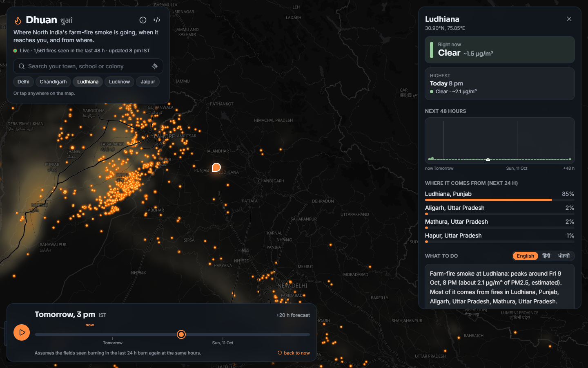
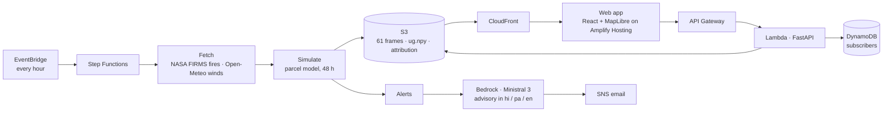

# Dhuan (धुआं)

**Where is the stubble smoke going, and when does it reach you?**

**Live: https://main.d9com2kyiohi6.amplifyapp.com** · tap any place in North India, no sign-up.



Every October and November, rice stubble is burnt across Punjab, Haryana and western Uttar Pradesh, and the smoke
drifts for hundreds of kilometres. Air-quality apps tell you how bad it is right now. Dhuan tells you what is coming.
Every hour it pulls NASA's satellite fire detections and the hourly wind forecast, simulates where each fire's smoke
travels over the next 48 hours, and for any place tells you **when the smoke arrives, when it peaks, how heavy it is,
and which districts it came from**. Subscribe and you get a day's notice by email, in English, Hindi or Punjabi.

Built solo in a weekend for WeMakeDevs × AWS **Environmental Hacks** (8–11 Oct 2026), Air track.

## How it works



1. **See the fires.** VIIRS on three satellites (Suomi NPP, NOAA-20, NOAA-21) spots active fires at 375 m. FIRMS
   publishes the last 48 hours over South Asia as a CSV, no key needed. Low-confidence pixels are dropped and
   repeat detections of the same field are merged.
2. **Follow the wind.** Open-Meteo gives the hourly wind at 100 m and the boundary-layer height on a 1° grid, two
   days back and three ahead, in one request.
3. **Carry the smoke.** Each fire releases parcels over the hours it burns. Parcels drift with the wind, spread with
   turbulence, settle slowly, and are binned onto a 5 km grid each hour, divided by the depth of air they are mixed
   through. Smoke trapped under a shallow night layer means dirtier air at ground level. Fields seen burning in the
   last 24 h are assumed to burn again for two days (a persistence forecast), and the app says so.
4. **Tell people early.** The point forecast gives arrival, peak, how heavy, and the top source districts. Alerts go
   out when moderate or heavier smoke is expected within 36 hours; Ministral 3 on Amazon Bedrock rewrites the
   advisory in the subscriber's language from a template that is always right about the numbers.

The physics, the parameters, how the index becomes an estimated µg/m³, and what the model does not know are in
[docs/model.md](docs/model.md). It is an indicative transport model, not an official forecast, and the app says
that too.

## Run it locally (no AWS needed)

```bash
# backend: Python 3.13 + uv
cd backend
uv sync
uv run python -m dhuan.run              # fetch live fires and winds, simulate, render frames to backend/out (about a minute)
uv run uvicorn dhuan.api:app --port 8000

# frontend: Node 24, in another terminal
cd frontend
npm install
npm run dev                             # http://localhost:5173, proxies /api and /data to :8000
```

Everything works offline except the Hindi/Punjabi rewrite of advisories, which needs Bedrock
(`DHUAN_LLM=bedrock` and AWS credentials in ap-south-1); without it the Hindi template is used and Punjabi falls back
to English. Locally, "emails" are written to `backend/out/outbox/`.

## Tests

```bash
cd backend && uv run pytest -q          # readers, model (downwind travel, attribution, persistence), full pipeline + API
cd frontend && npm run build            # type-check and bundle
cd frontend && npm run screenshots      # headless Chrome screenshots of the running dev server
```

## Deploy (Ship It)

One CloudFormation/SAM stack in ap-south-1 (Mumbai): API Gateway + Lambda (FastAPI), a Step Functions workflow on an
hourly EventBridge schedule, S3 behind CloudFront for the frames, DynamoDB for subscribers, SNS for email, Bedrock
for advisories. The site is on Amplify Hosting. Every push to `main` redeploys through GitHub Actions, authenticating
to AWS with OIDC (no keys in GitHub). See [DEPLOY.md](DEPLOY.md).

Idle cost is a few rupees a day: the hourly run is about 90 seconds of Lambda, the frames are a few megabytes, and
Ministral 3 costs a fraction of a paisa per advisory.

## Repository

| Path | What |
|---|---|
| `backend/dhuan/sources/` | Readers for NASA FIRMS fires and Open-Meteo winds |
| `backend/dhuan/model.py` | The parcel model: release, transport, mixing depth, attribution |
| `backend/dhuan/run.py`, `forecast.py`, `render.py` | The hourly run, the point forecast, the PNG frames |
| `backend/dhuan/api.py`, `alerts.py`, `advisory.py` | FastAPI app, subscriptions and alerts, advisories in three languages |
| `backend/dhuan/handlers.py` | Lambda entry points for the API and the Step Functions tasks |
| `frontend/` | React + TypeScript + Tailwind + MapLibre web app |
| `infra/` | SAM template, Amplify deploy script |
| `data/` | District raster built from Census 2011 boundaries (`backend/scripts/build_districts.py`) |
| `docs/model.md` | The model, its parameters and its limits |

## Data, credits and AI tools

* **Fires:** NASA FIRMS (LANCE), VIIRS 375 m. *We acknowledge the use of data from NASA's Fire Information for Resource
  Management System (FIRMS), part of NASA's Earth Science Data and Information System (ESDIS).*
* **Weather:** [Open-Meteo](https://open-meteo.com), CC BY 4.0.
* **District boundaries:** Census 2011, via [udit-001/india-maps-data](https://github.com/udit-001/india-maps-data) (MIT).
* **Map tiles:** [OpenFreeMap](https://openfreemap.org), © OpenStreetMap contributors. **Place search:** Open-Meteo
  geocoding and Nominatim.
* **Libraries:** numpy, Pillow, FastAPI, Mangum, pydantic, boto3; React, Vite, Tailwind, MapLibre GL, lucide-react,
  Playwright (screenshots). The Lambda bundling script and Amplify deploy script are adapted from the deploy
  skeleton of my earlier project [ClaimBack](https://github.com/HitanshGithub/claimback) (MIT, mine).
* **AI tools used**, as the rules require them to be declared: **Claude Code (Claude)** wrote most of the code in
  this repository, directed and reviewed by me throughout the event; I chose the problem, the model design and its
  assumptions, the data sources, the architecture, and checked the outputs. **Ministral 3 14B on Amazon Bedrock**
  runs inside the product to write advisories in Hindi and Punjabi.

Dhuan gives an indicative estimate, not medical or official air-quality advice.

MIT licence.
